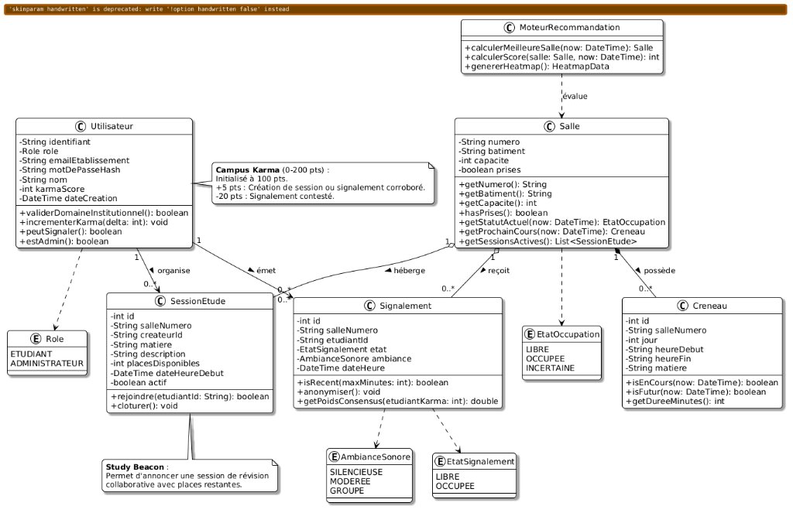
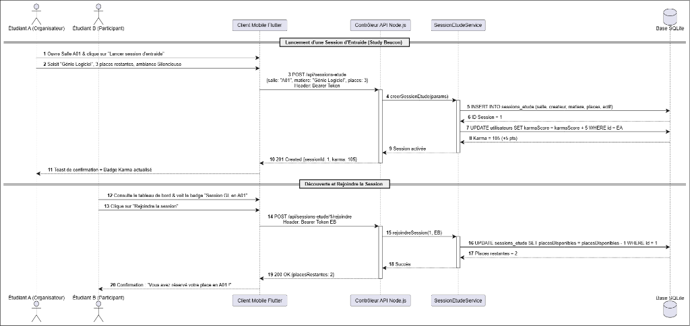

# SalleLibre - Système de Repérage & d'Entraide pour Salles de Révision

[](backend/tests/backend.test.js)
[](backend/public/index.html)
[](docs/Cahier_des_charges_-_SalleLibre.pdf)
[](docs/03_documentation_technique_et_guide_deploiement.md)

Dépôt officiel du projet universitaire **SalleLibre**, développé dans le cadre du module de **Génie Logiciel & Conception UML**, en stricte conformité avec le **Cahier des charges officiel** (Version 1.0, Octobre 2026).

Le projet allie l'**ingénierie logicielle formelle (UML 2.5)** à une **implémentation minimaliste, robuste et zéro-bloat (Standard Ponytail)** : backend Node.js avec base SQLite native (`node:sqlite`) et interface web réactive (HTML5 / CSS3 / JavaScript natif) servie directement sans aucun outil de build complexe.

---

## 📐 Conception & Modélisation UML

### 1. Diagramme de Classes Complet
Modélisation des entités fondamentales (`Salle`, `Creneau`, `Signalement`, `Utilisateur`) enrichie par le moteur de consensus (`Campus Karma`), les sessions d'entraide (`SessionEtude / Study Beacon`) et le crowdsourcing d'ambiance sonore.



### 2. Diagramme de Séquence : Lancement & Réservation d'une Session d'Entraide (Study Beacon)
Traçabilité complète des interactions asynchrones entre le client web réactif, l'API REST Node.js, le service métier et la base de données relationnelle persistante SQLite.



---

## 🌟 Fonctionnalités & Respect du Cahier des Charges

### B1. Gestion des Salles Libres (Temps Réel)
- Visualisation en direct des salles libres selon l'emploi du temps officiel.
- Filtres combinables : Bâtiment (A, B, C), Capacité minimale, et Présence de prises électriques.
- Affichage automatique de l'heure du prochain cours programmé et du temps restant disponible.
- **Élévation :** Algorithme « Meilleur Choix Révision » (`/api/salles/recommandation`) calculant le compromis optimal (temps libre, prises, calme).

### B2. Gestion des Signalements & Crowdsourcing
- Signalement par les étudiants connectés (`LIBRE` ou `OCCUPEE`).
- Dégradation automatique de l'état vers `INCERTAINE` après 30 minutes sans confirmation.
- Règle anti-spam stricte : quota d'un signalement par salle toutes les 10 minutes par étudiant.
- **Élévation :** Crowdsourcing de l'ambiance sonore (`SILENCIEUSE`, `MODEREE`, `GROUPE`) et système de réputation `Campus Karma` (consensus pondéré).

### B3. Gestion des Emplois du Temps & Administration
- Module d'importation CSV dédié à la scolarité.
- Validation syntaxique et sémantique rigoureuse avec rejet immédiat des fichiers erronés et **indication précise du numéro de ligne défaillant** (ex: ligne 4).
- **Élévation :** Matrice d'affluence campus (Heatmap hebdomadaire de 08h à 19h).

### B4. Robustesse, Hors-ligne & Respect RGPD
- Cache hors-ligne local (`localStorage`) : affichage transparent des dernières données sauvegardées avec horodatage d'actualisation en cas de coupure réseau.
- Filtrage strict par domaine institutionnel (`@univ.tn`).
- Purge et anonymisation automatique RGPD des signalements après 24 heures (tâche planifiée automatique).

---

## 🚀 Démarrage Rapide

### Option 1 : Démonstration Rapide en 1 Clic (Windows)
Double-cliquez sur :
```bat
start_demo.bat
```
*Le script initialise la base SQLite avec le jeu de données universitaire complet, démarre le serveur Node.js et ouvre directement l'application dans votre navigateur sur `http://localhost:3005`.*

### Option 2 : Lancement Manuel
```bash
# 1. Aller dans le dossier backend
cd backend

# 2. Installer les dépendances minimales (Express, Cors, Bcrypt, JWT)
npm install

# 3. Initialiser les données de démonstration
node src/database/seed_demo.js

# 4. Démarrer le serveur unifié (API + Interface Web)
npm start
# L'application est immédiatement accessible sur http://localhost:3005
```

---

## 🧪 Validation & Tests Automatisés (Evidence-Gated)

Toutes les exigences et règles métier sont validées par une suite de tests unitaires et d'intégration native :

```bash
cd backend
npm test
```
*Résultat garanti : 16/16 assertions validées à 100% avec code de retour 0 (zéro avertissement, exécution en moins de 200 ms).*

---

## 🔑 Comptes de Démonstration

| Rôle | Email | Mot de passe | Permissions |
|---|---|---|---|
| **Étudiant 1** | `etudiant1@univ.tn` | `etudiant123` | Consultation, filtres, signalement, lancement de session d'étude |
| **Étudiant 2** | `etudiant2@univ.tn` | `etudiant123` | Rejoindre une session, validation croisée des signalements |
| **Scolarité (Admin)** | `admin@univ.tn` | `admin123` | Import CSV, diagnostic des erreurs, heatmap d'affluence, purge RGPD |

---

## 📂 Documentation & Livrables Universitaires

- 📄 **[Cahier des charges officiel (PDF)](docs/Cahier_des_charges_-_SalleLibre.pdf)**
- 📐 **[Conception UML & 13 Scénarios Détaillés](docs/02_diagrammes_uml_et_scenarios.md)**
- 📊 **[Matrice de Traçabilité des Exigences](docs/01_analyse_exigences_tracabilite.md)**
- 🛠️ **[Documentation Technique & API](docs/03_documentation_technique_et_guide_deploiement.md)**
- 🎓 **[Rapport Académique de Synthèse](docs/04_rapport_academique_sallelibre.md)**
- 💻 **[Banc d'Essai Interactif (Showcase Standalone)](showcase/salle_libre_showcase.html)**
