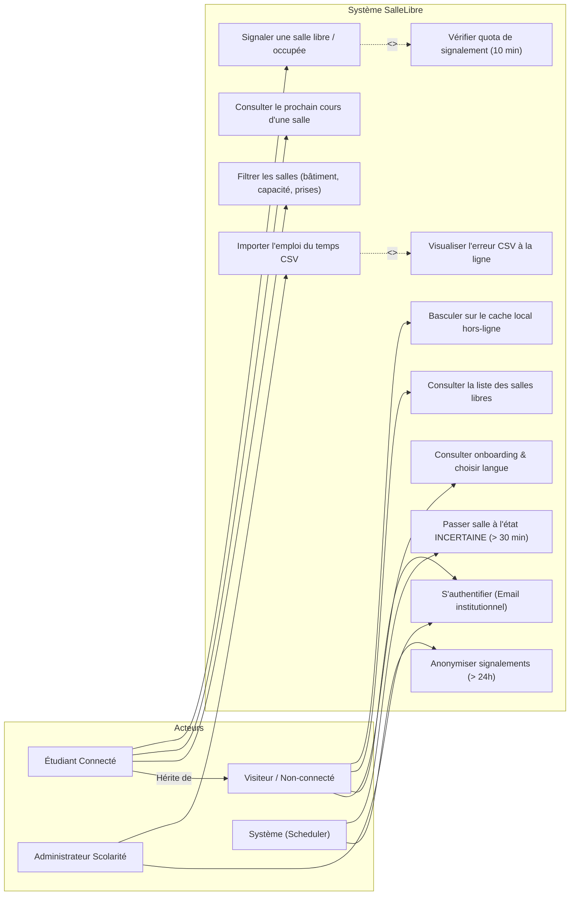
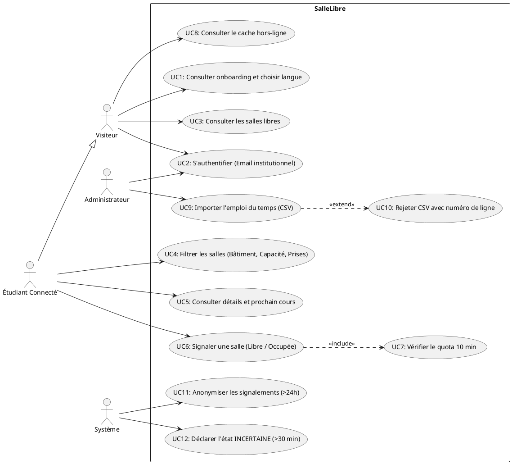
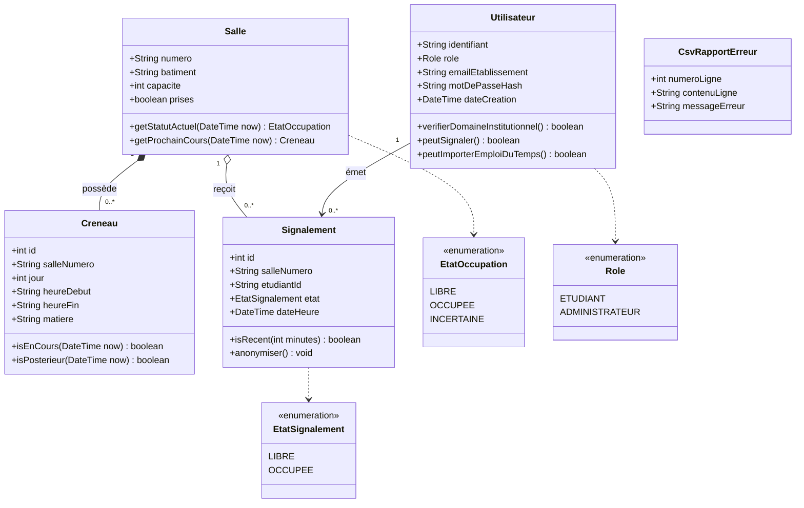
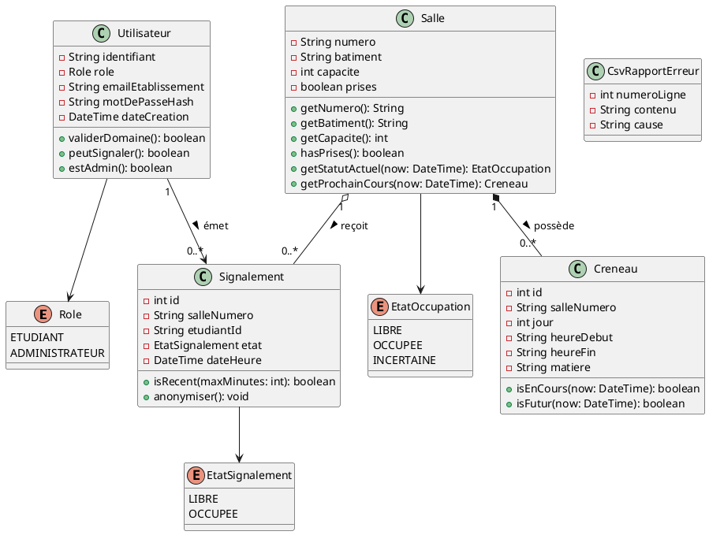
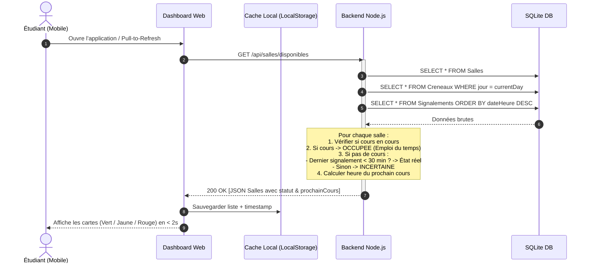
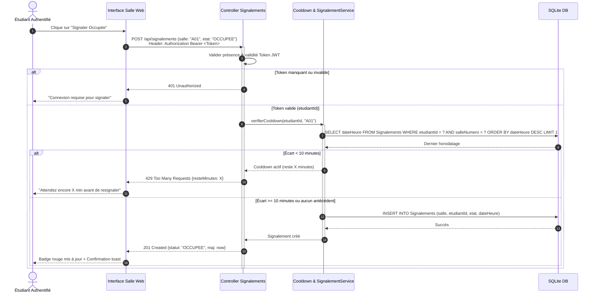

# SalleLibre - Modélisation UML Complète et Spécification des Scénarios

**Projet :** SalleLibre  
**Document :** Conception Logicielle UML (Use Case, Classes, Séquences, Scénarios)  
**Standard :** UML 2.5 / PlantUML & Mermaid  

---

## 1. Diagramme des Cas d'Utilisation (Use Case Diagram)

### 1.1 Modélisation Visuelle (Mermaid)



### 1.2 Description en Syntaxe PlantUML



---

## 2. Diagramme de Classes Structurel (Class Diagram)

Ce diagramme concilie strictement les entités requises dans le Cahier des charges (page 3) et l'architecture logicielle réelle mise en œuvre dans le code source.

### 2.1 Modélisation Visuelle (Mermaid)



### 2.2 Description en Syntaxe PlantUML



---

## 3. Les 13 Scénarios Textuels Détaillés

### Scénario 1 : Authentification Étudiant via Email Institutionnel
* **Identifiant :** SC-01
* **Acteur :** Étudiant.
* **Objectif :** Accéder aux privilèges de signalement sur le campus.
* **Préconditions :** L'étudiant possède un compte avec une adresse institutionnelle valide (ex: `@univ.tn`).
* **Scénario Nominal :**
  1. L'étudiant accède à l'écran de connexion.
  2. L'étudiant renseigne son adresse e-mail (`etudiant@univ.tn`) et son mot de passe.
  3. L'application vérifie la conformité syntaxique du domaine institutionnel.
  4. L'application transmet la requête au backend Node.js (`POST /api/auth/login`).
  5. Le backend vérifie le mot de passe hashé et génère un jeton JWT contenant l'identifiant et le rôle `ETUDIANT`.
  6. L'application enregistre le token de manière sécurisée et redirige l'étudiant vers le tableau de bord avec les privilèges de signalement débloqués.
* **Flux Alternatifs :**
  - **A1 (Première connexion) :** L'application présente le consentement obligatoire sur la politique de confidentialité (données collectées, anonymisation 24h) avant la validation finale.
* **Flux d'Exception :**
  - **E1 (Email non-institutionnel) :** L'étudiant saisit une adresse grand public (ex: `user@gmail.com`). L'application rejette la saisie avec le message : *"Seules les adresses e-mail de l'établissement sont autorisées."*
  - **E2 (Identifiants invalides) :** Le backend renvoie `401 Unauthorized`. L'application affiche *"Identifiant ou mot de passe incorrect."*
* **Postconditions :** L'étudiant est authentifié ; son identifiant est injecté dans les en-têtes des futures requêtes de signalement.

---

### Scénario 2 : Consultation de la Liste des Salles Libres
* **Identifiant :** SC-02
* **Acteur :** Étudiant (connecté ou visiteur).
* **Objectif :** Trouver rapidement une salle d'étude libre à l'instant présent.
* **Préconditions :** Le serveur Node.js est accessible.
* **Scénario Nominal :**
  1. L'utilisateur lance l'application ou actualise le tableau de bord (Pull-to-refresh).
  2. L'application interroge l'endpoint `GET /api/salles/disponibles`.
  3. Le serveur analyse la date/heure courante et filtre les salles sans cours planifié à cet instant précis selon les créneaux de la base SQLite.
  4. Pour chaque salle libre, le serveur inspecte le dernier signalement enregistré :
     - Si signalement < 30 min : statut = `LIBRE` ou `OCCUPEE`.
     - Si aucun signalement ou signalement > 30 min : statut = `INCERTAINE`.
  5. L'application affiche la liste triée avec indicateurs de statut colorés (Vert: Libre, Jaune: Incertaine, Rouge: Occupée) et heure de dernière mise à jour.
  6. L'application sauvegarde la réponse dans le cache local SQLite / SharedPreferences.
* **Flux d'Exception :**
  - **E1 (Aucune salle libre) :** Le système affiche un message bienveillant : *"Aucune salle n'est libre actuellement sur le campus."*
* **Postconditions :** La liste est affichée en moins de 2 secondes et persistée localement.

---

### Scénario 3 : Filtrage Multi-critères (Bâtiment, Capacité, Prises)
* **Identifiant :** SC-03
* **Acteur :** Étudiant.
* **Objectif :** Cibler une salle répondant à des besoins spécifiques de révision (ex: recharger son PC portable dans le bâtiment B).
* **Préconditions :** L'utilisateur est sur l'écran des salles disponibles.
* **Scénario Nominal :**
  1. L'utilisateur clique sur le bouton de filtre.
  2. Une feuille de filtre ergonomique (BottomSheet accessible d'une main) s'ouvre.
  3. L'utilisateur sélectionne :
     - Bâtiment : **Bâtiment B**.
     - Présence de prises électriques : **Oui**.
     - Capacité minimale : **30 places**.
  4. L'utilisateur valide.
  5. L'application filtre dynamiquement la liste (ou transmet les paramètres `?batiment=B&prises=true&minCapacite=30`).
  6. La vue présente uniquement les salles conformes (ex: Salle B102, 40 places, prises présentes).
  7. L'utilisateur peut réinitialiser les filtres en 1 tap ("Effacer les filtres").
* **Postconditions :** L'affichage est restreint aux salles filtrées ; l'état des filtres reste mémorisé durant la session.

---

### Scénario 4 : Consultation du Prochain Cours Planifié
* **Identifiant :** SC-04
* **Acteur :** Étudiant.
* **Objectif :** Savoir combien de temps la salle restera libre avant le début d'un cours officiel.
* **Préconditions :** Une salle libre est affichée.
* **Scénario Nominal :**
  1. L'étudiant clique sur la carte de la salle (ex: "Salle A01").
  2. L'écran de détail s'affiche.
  3. L'application met en avant l'encadré du prochain cours :
     - Si un cours suit aujourd'hui : *"Prochain cours à 14:00 (Algorithmique et Structures de Données)"*.
     - Si aucun cours ultérieur : *"Aucun cours prévu pour le reste de la journée"*.
  4. L'étudiant peut ainsi organiser sa session de révision en toute sérénité.
* **Postconditions :** L'étudiant connaît la durée maximale de disponibilité sans interruption.

---

### Scénario 5 : Signalement d'une Salle Occupée
* **Identifiant :** SC-05
* **Acteur :** Étudiant Connecté.
* **Objectif :** Prévenir les autres étudiants qu'une salle officiellement libre est en réalité occupée (ex: groupe de révision complet, réunion impromptue).
* **Préconditions :** L'étudiant est connecté et n'a pas soumis de signalement pour cette salle depuis au moins 10 minutes.
* **Scénario Nominal :**
  1. L'étudiant consulte la fiche de la salle "A01".
  2. L'étudiant clique sur le bouton rouge *"Signaler Occupée"*.
  3. L'application envoie `POST /api/signalements` avec `{ salleNumero: "A01", etat: "OCCUPEE" }` et le Bearer Token.
  4. Le serveur vérifie l'absence de cooldown actif pour ce couple (étudiantId, salleNumero).
  5. Le serveur insère le signalement avec l'horodatage courant `dateHeure = now()`.
  6. Le statut de la salle bascule immédiatement à `OCCUPEE` (Signalée il y a 1 min).
  7. Un message de confirmation toast s'affiche : *"Merci pour votre contribution ! Salle signalée occupée."*
* **Postconditions :** La salle apparaît rouge pour tous les étudiants du campus ; le cooldown de 10 min est enclenché pour cet étudiant sur cette salle.

---

### Scénario 6 : Signalement d'une Salle Libre
* **Identifiant :** SC-06
* **Acteur :** Étudiant Connecté.
* **Objectif :** Confirmer la disponibilité réelle d'une salle incertaine.
* **Préconditions :** L'étudiant est connecté et se trouve dans la salle ou à proximité.
* **Scénario Nominal :**
  1. L'étudiant constate que la salle "C204" est vide et silencieuse.
  2. Il clique sur *"Signaler Libre"*.
  3. L'application émet la requête `POST /api/signalements` avec `{ salleNumero: "C204", etat: "LIBRE" }`.
  4. Le serveur valide l'identité et le quota, puis enregistre l'événement.
  5. Le statut de la salle passe de `INCERTAINE` à `LIBRE (Confirmée)` avec l'heure exacte.
  6. L'application actualise le compteur de confirmation.
* **Postconditions :** Le statut incertain est levé pour les 30 prochaines minutes.

---

### Scénario 7 : Tentative de Signalement par un Utilisateur Non-Authentifié
* **Identifiant :** SC-07
* **Acteur :** Visiteur / Utilisateur non connecté.
* **Objectif :** Empêcher le vandalisme et les faux signalements anonymes (Règle B2.2).
* **Préconditions :** L'utilisateur consulte l'application sans s'être connecté.
* **Scénario Nominal :**
  1. Le visiteur consulte la liste des salles et ouvre la fiche de la salle "B12".
  2. Le visiteur clique sur le bouton *"Signaler Libre"*.
  3. L'application intercepte l'absence de session authentifiée et affiche une boîte de dialogue explicative : *"Connexion requise : Vous devez être connecté avec votre compte institutionnel pour signaler l'état d'une salle."*
  4. Si une requête HTTP directe est forgée sans en-tête `Authorization`, le serveur Node.js intercepte la requête via `authMiddleware` et renvoie immédiatement `401 Unauthorized` avec `{ "erreur": "Authentification requise pour cette opération." }`.
* **Postconditions :** Aucun signalement n'est inscrit en base de données.

---

### Scénario 8 : Tentative de Double Signalement sous Cooldown (Règle des 10 Minutes)
* **Identifiant :** SC-08
* **Acteur :** Étudiant Connecté.
* **Objectif :** Empêcher le matraquage ou la falsification rapide d'état (Règle B2.4).
* **Préconditions :** L'étudiant a signalé la salle "A01" il y a 3 minutes.
* **Scénario Nominal :**
  1. L'étudiant tente de cliquer à nouveau sur *"Signaler Occupée"* pour la même salle "A01".
  2. L'application désactive visuellement le bouton et affiche un compte à rebours : *"Prochain signalement possible dans 7 min"*.
  3. Si l'appel API est forcé, le contrôleur backend vérifie `dernierSignalement(etudiantId, salleNumero)` :
     - La différence `maintenant - dernierSignalement` est de 3 minutes (< 10 minutes).
  4. Le backend renvoie `429 Too Many Requests` avec `{ "erreur": "Veuillez patienter 7 minute(s) avant de soumettre un nouveau signalement pour cette salle." }`.
* **Postconditions :** La base de données reste intègre, le signalement précédent est conservé.

---

### Scénario 9 : Bascule Automatique vers l'État "INCERTAINE" (> 30 Minutes)
* **Identifiant :** SC-09
* **Acteur :** Système / Moteur d'état.
* **Objectif :** Garantir la véracité des informations en signalant aux étudiants les données non fraîches (Règle B2.3).
* **Préconditions :** La salle "B05" est libre à l'emploi du temps. Son dernier signalement étudiant date de 10h15. L'heure de consultation est 10h46 (soit 31 minutes écoulées).
* **Scénario Nominal :**
  1. Un étudiant consulte la liste des salles à 10h46.
  2. Le service backend calcule pour la salle "B05" :
     - Cours à l'emploi du temps ? Aucun. (Théoriquement libre).
     - Dernier signalement ? Reçu il y a 31 minutes (> seuil de 30 minutes).
  3. Le système attribue le libellé et statut `INCERTAINE`.
  4. L'application affiche un badge jaune avertissant : *"Dernière confirmation il y a plus de 30 min (État incertain)"*.
* **Postconditions :** L'étudiant sait qu'il doit vérifier sur place ou confirmer lui-même l'état réel.

---

### Scénario 10 : Importation Réussie d'un Emploi du Temps CSV par l'Administrateur
* **Identifiant :** SC-10
* **Acteur :** Administrateur Scolarité.
* **Objectif :** Mettre à jour l'ensemble de la grille des cours pour la semaine (Règle B3.1).
* **Préconditions :** L'utilisateur est connecté avec le rôle `ADMINISTRATEUR`. Le fichier `emploi_du_temps_semaine.csv` est correctement formaté.
* **Scénario Nominal :**
  1. L'administrateur se rend sur l'onglet d'administration.
  2. Il sélectionne le fichier CSV via le sélecteur de documents.
  3. L'application transmet le fichier via `POST /api/admin/emplois-du-temps/import`.
  4. Le service Node.js `CsvParserService` exécute un parsing pas-à-pas avec validation transactionnelle :
     - Vérification de l'en-tête : `salle,jour,heureDebut,heureFin,matiere`.
     - Vérification de l'existence des salles correspondantes.
     - Contrôle des formats d'heures (HH:MM) et cohérence chronologique (`heureDebut < heureFin`).
  5. Tous les enregistrements (ex: 45 créneaux) sont insérés avec succès.
  6. Le backend renvoie `200 OK` avec `{ "succes": true, "creneauxImportes": 45 }`.
  7. L'interface affiche une confirmation claire : *"Importation réussie : 45 créneaux mis à jour."*
* **Postconditions :** Les disponibilités instantanées de tout le campus sont immédiatement recalculées selon le nouvel emploi du temps.

---

### Scénario 11 : Rejet d'un Fichier CSV Invalide avec Signalement de la Ligne
* **Identifiant :** SC-11
* **Acteur :** Administrateur Scolarité.
* **Objectif :** Identifier immédiatement la ligne corrompue dans un fichier volumineux (Règle B3.2).
* **Préconditions :** Le fichier CSV contient une erreur à la ligne 4 (ex: `A01,Lundi,14:00,12:00,Mathématiques` où l'heure de fin précède l'heure de début).
* **Scénario Nominal :**
  1. L'administrateur soumet le fichier erroné.
  2. Le parseur backend analyse séquentiellement :
     - Ligne 1 : En-têtes valides.
     - Ligne 2 : Valide.
     - Ligne 3 : Valide.
     - Ligne 4 : Incohérence temporelle détectée (`heureFin <= heureDebut`).
  3. Le parseur interrompt la transaction (aucun enregistrement partiel polluant) et lève une exception `CsvValidationError`.
  4. Le backend renvoie `400 Bad Request` avec :
     ```json
     {
       "succes": false,
       "erreur": "Erreur de formatage CSV à la ligne 4 : L'heure de fin (12:00) doit être postérieure à l'heure de début (14:00).",
       "numeroLigne": 4,
       "ligneBrute": "A01,Lundi,14:00,12:00,Mathématiques"
     }
     ```
  5. L'interface Web affiche un dialogue d'alerte rouge mettant en évidence le numéro de ligne **4** et le motif de rejet.
* **Postconditions :** La base de données reste dans son état antérieur intègre. L'administrateur sait exactement où corriger son fichier.

---

### Scénario 12 : Résilience en Cas d'Indisponibilité du Serveur
* **Identifiant :** SC-12
* **Acteur :** Étudiant.
* **Objectif :** Pouvoir consulter les données récemment enregistrées même si le serveur de scolarité subit une coupure (Règle B4.1).
* **Préconditions :** L'étudiant a consulté l'application il y a 15 minutes. Le serveur Node.js est arrêté ou injoignable.
* **Scénario Nominal :**
  1. L'étudiant ouvre l'application.
  2. L'application émet la requête HTTP vers le serveur, qui échoue (Connection refused / Timeout).
  3. Le gestionnaire d'erreur de l'application intercepte l'exception sans planter (anti-crash).
  4. L'application charge immédiatement la liste persistée dans le stockage local localisé.
  5. Un bandeau persistant orange en haut d'écran informe l'utilisateur : *"Serveur inaccessible. Affichage de la dernière liste enregistrée à 10:30."*
  6. Les boutons de signalement dynamique sont désactivés avec mention *"Indisponible hors-ligne"*.
* **Postconditions :** L'application reste stable, fluide et utile sans interruption brutale.

---

### Scénario 13 : Perte de Connectivité Internet (Mode Déconnecté)
* **Identifiant :** SC-13
* **Acteur :** Étudiant.
* **Objectif :** Avertir l'étudiant de la péremption potentielle des données hors Wi-Fi (Règle B4.2).
* **Préconditions :** L'étudiant se déplace dans une zone blanche du campus non couverte par le Wi-Fi (ex: sous-sol).
* **Scénario Nominal :**
  1. L'application détecte la coupure du signal réseau via le `ConnectivityService`.
  2. L'application bascule en mode cache hors-ligne.
  3. Un bandeau d'avertissement jaune s'affiche instantanément : *"Aucune connexion réseau. Les données affichées sont susceptibles d'être périmées."*
  4. L'étudiant peut continuer à filtrer et lire les informations déjà téléchargées.
  5. Dès que le signal Wi-Fi revient, le bandeau disparaît et une resynchronisation silencieuse s'exécute.
* **Postconditions :** L'étudiant est pleinement informé de la fraîcheur relative des données.

---

## 4. Diagrammes de Séquence Clés

### 4.1 Séquence 1 : Consultation et Calcul Dynamique des Salles Libres (B1.1, B1.3, B2.3)



### 4.2 Séquence 2 : Soumission d'un Signalement et Règle Anti-Spam 10 min (B2.1, B2.2, B2.4)



### 4.3 Séquence 3 : Importation CSV avec Détection d'Erreur à la Ligne (B3.1, B3.2)

```mermaid
sequenceDiagram
    autonumber
    actor Admin as Administrateur Scolarité
    participant UI as Panneau Admin Web
    participant API as AdminTimetableController
    participant Parser as CsvValidationService
    participant DB as SQLite DB

    Admin->>UI: Sélectionne "emplois_2026.csv" et valide
    UI->>API: POST /api/admin/emplois-du-temps/import (multipart/form-data)
    activate API
    API->>API: Vérifier rôle == 'ADMINISTRATEUR'
    alt Non-admin
        API-->>UI: 403 Forbidden
    else Admin autorisé
        API->>Parser: parserEtValider(contenuCsv)
        activate Parser
        loop Pour chaque ligne (i = 2 à N)
            Parser->>Parser: Vérifier syntaxe, colonnes, format HH:MM, chronologie
            alt Erreur détectée à la ligne K
                Parser-->>API: Throw CsvError(ligne: K, cause: "Heure fin <= début")
                API-->>UI: 400 Bad Request {ligne: K, message: "Erreur ligne K"}
                UI-->>Admin: Modale rouge : Erreur ligne K
            end
        end
        Parser->>DB: BEGIN TRANSACTION; DELETE FROM Creneaux; INSERT batch; COMMIT;
        DB-->>Parser: Succès
        Parser-->>API: 45 créneaux insérés
        deactivate Parser
        API-->>UI: 200 OK {succes: true, total: 45}
        UI-->>Admin: "Importation réussie : 45 créneaux enregistrés"
    end
    deactivate API
```

---

## 5. Synthèse de la Cohérence Globale

L'ensemble des éléments modélisés (Acteurs, Use Cases, Classes, Relations de multiplicité, Scénarios nominaux et d'exception, Diagrammes de séquence) répondent sans aucune omission aux exigences du Cahier des charges :
1. **Entités de données :** `Salle`, `Creneau`, `Signalement`, `Utilisateur` respectent fidèlement les attributs et associations demandés.
2. **Gestion temporelle :** Les règles des 30 minutes (incertitude), des 10 minutes (cooldown), et des 24 heures (anonymisation RGPD) sont intégrées nativement dans la modélisation.
3. **Robustesse et déconnexion :** Les scénarios de résilience garantissent une expérience sans crash, conforme au standard de génie logiciel universitaire.
