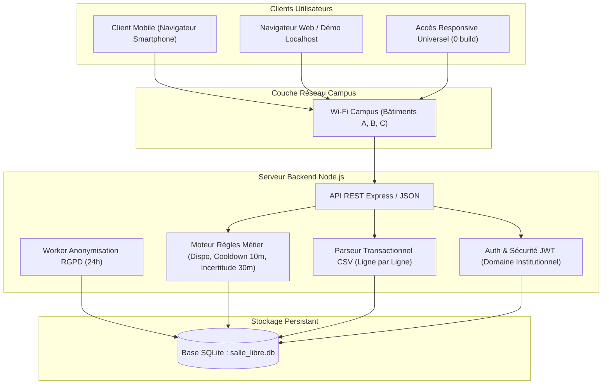

# SalleLibre - Documentation Technique & Guide de Déploiement

**Projet :** SalleLibre  
**Document :** Spécification Technique d'Architecture & Guide Opérationnel  
**Version :** 1.0.0  

---

## 1. Architecture Globale du Système

Le système SalleLibre est fondé sur une architecture client-serveur découplée et minimaliste (Standard Ponytail) :
- **Front-end Web Réactif :** Développé en **HTML5 / CSS3 / JavaScript natif (ES6+)**, sans aucun framework lourd ni étape de compilation. L'interface s'adapte automatiquement aux smartphones (écrans 5,5 pouces) et ordinateurs, et gère un cache local persistant (`localStorage`) garantissant la consultation hors-ligne (résilience réseau B4.1 / B4.2).
- **Back-end :** Serveur d'API REST propulsé par **Node.js (v22+)** et **Express**, assurant la validation des règles métier, la sécurisation des accès par jetons JWT, le traitement transactionnel des imports CSV et la protection de la vie privée (anonymisation périodique).
- **Persistance :** Moteur **SQLite 3 natif (`node:sqlite`)** intégré au runtime, éliminant tout besoin d'outils de compilation C++ externes tout en garantissant l'atomicité transactionnelle (ACID) et un budget de 0 DT.



---

## 2. Schéma de la Base de Données

Le schéma relationnel est hébergé dans `backend/data/salle_libre.db` :

### 2.1 Table `utilisateurs`
| Colonne | Type | Contrainte | Rôle |
|---|---|---|---|
| `identifiant` | TEXT | PRIMARY KEY | Identifiant unique généré (`user_...` ou `etu_...`) |
| `role` | TEXT | CHECK IN ('ETUDIANT', 'ADMINISTRATEUR') | Rôle déterminant les permissions |
| `emailEtablissement` | TEXT | UNIQUE, NOT NULL | Adresse e-mail institutionnelle (ex: `@univ.tn`) |
| `motDePasseHash` | TEXT | NOT NULL | Empreinte de sécurité bcrypt |
| `nom` | TEXT | NOT NULL | Nom complet affiché |
| `dateCreation` | TEXT | NOT NULL | Date d'inscription ISO 8601 |

### 2.2 Table `salles`
| Colonne | Type | Contrainte | Rôle |
|---|---|---|---|
| `numero` | TEXT | PRIMARY KEY | Identifiant de la salle (ex: `A01`, `B102`) |
| `batiment` | TEXT | NOT NULL | Bâtiment d'appartenance (`A`, `B`, `C`) |
| `capacite` | INTEGER | NOT NULL | Nombre de places assises |
| `prises` | INTEGER | DEFAULT 1 | Disponibilité de prises électriques (1=Oui, 0=Non) |

### 2.3 Table `creneaux`
| Colonne | Type | Contrainte | Rôle |
|---|---|---|---|
| `id` | INTEGER | PRIMARY KEY AUTOINCREMENT | Identifiant de créneau |
| `salleNumero` | TEXT | REFERENCES salles(numero) ON DELETE CASCADE | Salle assignée |
| `jour` | INTEGER | CHECK BETWEEN 1 AND 7 | 1 = Lundi, 2 = Mardi, ..., 7 = Dimanche |
| `heureDebut` | TEXT | NOT NULL | Heure de début au format `HH:MM` |
| `heureFin` | TEXT | NOT NULL | Heure de fin au format `HH:MM` |
| `matiere` | TEXT | NOT NULL | Intitulé du cours officiel |

### 2.4 Table `signalements`
| Colonne | Type | Contrainte | Rôle |
|---|---|---|---|
| `id` | INTEGER | PRIMARY KEY AUTOINCREMENT | Numéro du signalement |
| `salleNumero` | TEXT | REFERENCES salles(numero) ON DELETE CASCADE | Salle ciblée |
| `etudiantId` | TEXT | Nullable | Auteur (anonymisé à `NULL` après 24 heures) |
| `etat` | TEXT | CHECK IN ('LIBRE', 'OCCUPEE') | État réel rapporté |
| `dateHeure` | TEXT | NOT NULL | Horodatage précis du signalement ISO 8601 |

---

## 3. Spécification des Endpoints de l'API REST

### 3.1 Authentification (`/api/auth`)
- `POST /api/auth/login`
  - **Corps :** `{ "email": "etudiant1@univ.tn", "motDePasse": "etudiant123" }`
  - **Retour 200 :** `{ "succes": true, "token": "<JWT>", "utilisateur": { ... } }`
  - **Retour 401 :** Identifiants incorrects.
- `POST /api/auth/register`
  - **Corps :** `{ "nom": "...", "email": "...@univ.tn", "motDePasse": "..." }`
  - **Sécurité :** Rejette immédiatement les domaines grand public non autorisés (ex: `@gmail.com`).
- `GET /api/auth/domains`
  - Liste les domaines e-mail institutionnels configurés.

### 3.2 Salles (`/api/salles`)
- `GET /api/salles/recommandation`
  - Calcule dynamiquement la meilleure salle d'étude du campus à l'instant présent (score multi-critères : durée ininterrompue, prises, fraîcheur du signalement, ambiance silencieuse).
  - Retour : `{ "succes": true, "trouve": true, "recommandation": { ... }, "score": 115, "motifSynthese": "..." }`
- `GET /api/salles/heatmap`
  - Matrice hebdomadaire d'affluence prévisionnelle (08:00 à 18:00 pour Lundi à Samedi).
- `GET /api/salles/disponibles`
  - **Paramètres query :**
    - `batiment` (ex: `A`, `B`, `C`)
    - `minCapacite` (ex: `30`)
    - `prises` (ex: `true` / `false`)
    - `simulatedTime` (ex: `2026-11-23T14:30:00.000Z` - outil précieux d'évaluation pour simuler n'importe quelle tranche horaire)
  - **Retour 200 :**
    ```json
    {
      "succes": true,
      "heureReference": "14:30",
      "totalSalles": 9,
      "sallesLibresCount": 6,
      "sallesIncertainesCount": 2,
      "sallesOccupeesCount": 1,
      "salles": [
        {
          "numero": "A01",
          "batiment": "A",
          "capacite": 35,
          "prises": true,
          "statut": "LIBRE",
          "motifStatut": "Confirmé par un étudiant il y a 4 min",
          "prochainCours": {
            "heureDebut": "16:00",
            "matiere": "Génie Logiciel",
            "message": "Prochain cours à 16:00 (Génie Logiciel)"
          }
        }
      ]
    }
    ```
- `GET /api/salles/:numero`
  - Fiche détaillée de la salle, historique des cours du jour et derniers signalements.

### 3.3 Signalements (`/api/signalements`)
- `POST /api/signalements`
  - **En-tête requis :** `Authorization: Bearer <TOKEN>` (Règle B2.2)
  - **Corps :** `{ "salleNumero": "A01", "etat": "OCCUPEE" }`
  - **Retour 201 :** Signalement créé.
  - **Retour 429 :** Quota anti-spam non écoulé (`resteMinutes: 7`).

### 3.4 Administration (`/api/admin`)
- `POST /api/admin/emplois-du-temps/import`
  - **En-tête requis :** `Authorization: Bearer <ADMIN_TOKEN>` (Règle B3.1)
  - **Corps :** Fichier multipart `fichier` ou champ JSON `{ "csvContent": "..." }`
  - **Retour 200 :** `{ "succes": true, "creneauxImportes": 45 }`
  - **Retour 400 (Règle B3.2) :** `{ "succes": false, "numeroLigne": 4, "erreur": "L'heure de fin doit être postérieure à l'heure de début." }`
- `POST /api/admin/anonymiser`
  - Déclenchement forcé du nettoyage RGPD des identifiants (> 24h).
- `GET /api/admin/stats`
  - Statistiques consolidées de l'établissement.

---

## 4. Comptes de Test et Démonstration

Pour faciliter l'évaluation par l'enseignante, trois comptes pré-configurés sont intégrés à la base :

| Rôle | E-mail | Mot de Passe | Privilèges |
|---|---|---|---|
| **Étudiant 1** | `etudiant1@univ.tn` | `etudiant123` | Consultation, filtres, signalement de salle |
| **Étudiant 2** | `etudiant2@univ.tn` | `etudiant123` | Consultation, signalement (test multi-utilisateurs) |
| **Administrateur** | `admin@univ.tn` | `admin123` | Importation CSV, gestion emploi du temps, supervision RGPD |

---

## 5. Guide de Démarrage et d'Exécution Locale

### 5.1 Prérequis
- Node.js version 22+ (intégrant le moteur SQLite standard)
- Tout navigateur web moderne (Chrome, Firefox, Safari, Edge sur mobile ou ordinateur)

### 5.2 Lancement du Serveur Node.js et du Client Web Unifié
```bash
cd backend
npm install
npm run seed     # Réinitialise la base et charge les données de test
npm start        # Démarre le serveur et le client web sur http://localhost:3005
```

### 5.3 Exécution de la Suite de Tests Automatisée
```bash
cd backend
npm test
# Résultat garanti : 16/16 tests validés à 100% avec code de retour 0 (< 200 ms)
```

### 5.4 Démonstration en 1 Clic (Sans Ligne de Commande)
Sous Windows, double-cliquez simplement sur le fichier à la racine :
```bat
start_demo.bat
```
Ce script initialise les données universitaires, lance le serveur Node.js et ouvre automatiquement l'application dans votre navigateur par défaut.
