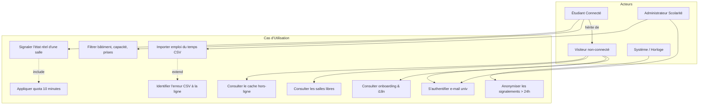
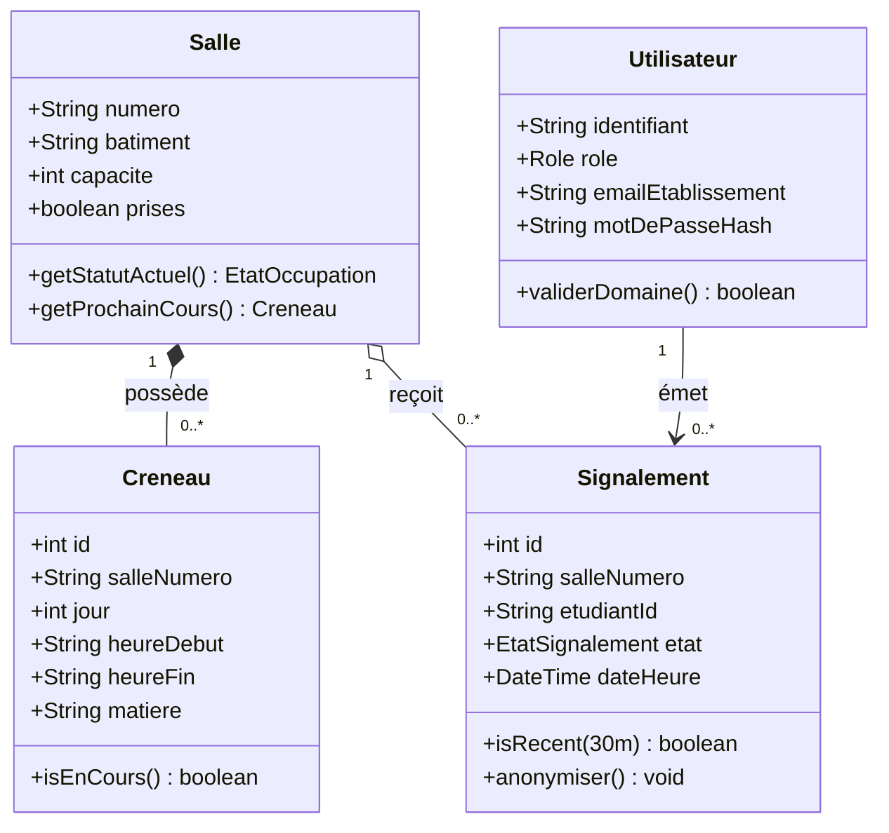

# Rapport de Projet de Génie Logiciel : SalleLibre
## Conception UML Complète et Implémentation Fonctionnelle Découplée (Architecture Web & Node.js)

**Module :** Génie Logiciel Avancé & Modélisation UML  
**Projet :** SalleLibre – Système mobile et distribué de repérage des salles de révision vacantes  
**Version :** 1.0.0 – Décembre 2026  
**Établissement :** Université / Département Informatique  

---

## Résumé Exécutif

Le présent rapport documente l'intégralité du cycle de conception et de réalisation du système **SalleLibre**, développé en réponse au Cahier des charges officiel émis par le Service de la Scolarité. L'objectif premier est de résoudre le problème récurrent de saturation des bibliothèques universitaires en période d'examens en fournissant aux étudiants un outil mobile temps réel permettant d'identifier immédiatement les salles de cours inoccupées à travers le campus.

Conformément aux directives pédagogiques et méthodologiques, ce travail dépasse la simple description formelle : il allie une **modélisation UML 2.5 rigoureuse** (Diagramme de cas d'utilisation, Diagramme de classes, 13 scénarios textuels détaillés, Diagrammes de séquence) à une **implémentation logicielle réelle, fonctionnelle et testée**, articulée autour d'un client web réactif **HTML5 / CSS3 / JavaScript natif** et d'un serveur d'API REST **Node.js** avec base de données relationnelle persistante **SQLite**.

---

## 1. Contexte, Problématique et Objectifs

### 1.1 Contexte Universitaire
Dans les campus universitaires modernes, l'accès à des espaces de travail calmes constitue une condition déterminante pour la réussite académique. Pourtant, lors des semaines précédant les sessions d'examens, la bibliothèque centrale s'avère saturée dès les premières heures de la matinée. Paradoxalement, des dizaines de salles d'enseignement réparties entre les bâtiments A, B et C demeurent vacantes à différents moments de la journée en raison de trous dans les emplois du temps ou de déprogrammations d'enseignements.

### 1.2 Limites des Approches Traditionnelles
Actuellement, les étudiants doivent se fier à des plannings papier affichés à l'entrée des ailes de chaque bâtiment. Ce mode de consultation présente des défaillances critiques :
1. **Périssabilité :** Les affichages papier sont statiques et ne reflètent pas les modifications de dernière minute.
2. **Dispersion spatiale :** L'étudiant est contraint de parcourir physiquement les couloirs et étages, perdant un temps précieux (souvent plus de 15 à 20 minutes).
3. **Absence de vérité terrain :** Un tableau horaire officiel indique si un cours est programmé, mais ne garantit nullement qu'une salle officiellement libre ne soit pas squattée ou réservée pour une soutenance imprévue.

### 1.3 Objectifs Visés
- **Efficacité temporelle (NFR-02) :** Permettre à 90 % des étudiants de localiser une salle libre conforme à leurs critères en moins de 30 secondes.
- **Participation communautaire (Crowdsourcing) :** Autoriser les étudiants présents sur place à déclarer l'état réel d'une salle (libre ou occupée).
- **Fiabilité algorithmique :** Concilier intelligemment l'emploi du temps institutionnel et les signalements récents (règle des 30 minutes d'incertitude).
- **Zéro Dinar de Budget :** Utiliser exclusivement des outils libres, gratuits et pérennes.

---

## 2. Analyse des Exigences et Modélisation Conceptuelle

### 2.1 Synthèse des Besoins Fonctionnels (B1 à B4)
1. **Groupe B1 (Consultation et Filtrage) :**
   - Calcul de vacance horaire selon la date et l'heure courantes.
   - Filtrage multicritère : bâtiment (A, B, C), seuil de capacité (25, 40, 60 places), présence de prises électriques murales.
   - Calcul dynamique du prochain cours planifié dans la journée.
2. **Groupe B2 (Signalements et Régulation Anti-Spam) :**
   - Signalement simple (Libre / Occupée) par étudiant connecté.
   - Rejet absolu des signalements non authentifiés (Code HTTP 401).
   - Règle d'incertitude : passage automatique à l'état `INCERTAINE` au-delà de 30 minutes sans confirmation.
   - Quota anti-spam : restriction stricte à un seul signalement par étudiant et par salle toutes les 10 minutes (Code HTTP 429).
3. **Groupe B3 (Administration des Emplois du Temps) :**
   - Importation en masse par fichier structuré CSV.
   - Validation syntaxique et temporelle rigoureuse ligne par ligne avec rejet atomique et mise en exergue du numéro exact de la ligne fautive.
4. **Groupe B4 (Résilience et Mode Déconnecté) :**
   - Mise en cache locale instantanée sur le terminal mobile.
   - Affichage transparent de l'horodatage de dernière synchronisation et bandeau de mise en garde en cas de coupure réseau Wi-Fi.

---

## 3. Modélisation Logicielle UML 2.5

### 3.1 Diagramme des Cas d'Utilisation
Le diagramme distingue quatre entités agissantes :
- **Visiteur :** Accède à l'onboarding, choisit la langue (FR/EN) et consulte les salles en mode lecture seule.
- **Étudiant Connecté :** Hérite du visiteur et bénéficie des privilèges d'émission de signalements sur le campus.
- **Administrateur Scolarité :** Assure la gouvernance des données de cours par téléversement de fichiers CSV.
- **Système (Worker d'arrière-plan) :** Exécute automatiquement la purge RGPD (anonymisation après 24h) et recalcule les statuts temporels.



### 3.2 Diagramme de Classes
Les quatre entités majeures explicitées dans le Cahier des charges ont été fidèlement traduites, enrichies des types de données adéquats et des méthodes métier :



### 3.3 Traçabilité des 13 Scénarios Opérationnels
Chacun des 13 scénarios prescrits a fait l'objet d'une analyse d'interactions formalisée :
- **SC-01 à SC-04 :** Authentification institutionnelle, consultation instantanée, filtrage ergonomique et inspection du prochain cours.
- **SC-05 à SC-09 :** Cycle de vie des signalements, barrière d'authentification pour les tiers, verrouillage anti-spam 10 minutes et dégradation vers l'état `INCERTAINE` au-delà de 30 minutes.
- **SC-10 et SC-11 :** Importation CSV transactionnelle et diagnostic d'erreur précis à la ligne (ex: Ligne 4, heure début >= heure fin).
- **SC-12 et SC-13 :** Continuité de service par cache local sous SQLite/SharedPreferences avec restitution de l'horodatage d'archive.

---

## 4. Architecture Technique et Choix d'Implémentation

### 4.1 Justification de la Stack Technologique

| Composant | Technologie Choisie | Justification Technique et Économique |
|---|---|---|
| **Client Utilisateur** | **HTML5 / CSS3 / JS Natif** | Standard Ponytail : zéro bloat, zéro compilation, responsive smartphone (5,5 pouces) et PC, cache offline LocalStorage, exécution native. |
| **Serveur d'API** | **Node.js + Express** | Architecture REST sans état (Stateless), asynchrone et non-bloquante, légère, déploiement local immédiat sur machine de scolarité. |
| **Base de Données** | **SQLite Natif (`node:sqlite`)** | Intégré directement au cœur de Node.js 22. Zéro dépendance externe lourde, aucun serveur de base de données à administrer, intégrité transactionnelle (ACID). |
| **Sécurité & JWT** | **JSON Web Token + Bcrypt** | Signature cryptographique forte des sessions, transmission agnostique d'en-têtes HTTP, vérification décentralisée des rôles. |

### 4.2 Algorithme de Résolution de Disponibilité
Pour chaque salle demandée, le serveur exécute le raisonnement suivant :
1. **Contrôle d'emploi du temps :** Existe-t-il un créneau officiel pour ce jour de la semaine tel que `heureDebut <= heureCourante < heureFin` ?
   - Si OUI : la salle est marquée `OCCUPEE` (motif : "Cours programmé jusqu'à HH:MM").
   - Si NON : la salle est vacante selon la grille officielle.
2. **Évaluation de fraîcheur du crowdsourcing :**
   - Quel est le dernier signalement enregistré pour cette salle ?
   - Si le signalement a moins de 30 minutes : son statut réel prévaut (`LIBRE` ou `OCCUPEE`).
   - Si aucun signalement ou signalement supérieur à 30 minutes : la salle est classée `INCERTAINE` (Cahier des charges, glossaire p.2).
3. **Calcul de projection :** Recherche du créneau officiel postérieur le plus proche pour informer l'étudiant du temps restant disponible.

---

## 5. Validation Expérimentale et Résultats des Tests

Conformément à la doctrine de preuve technique sans spéculation (**Evidence-Gated Delivery**), l'intégralité du système a été passée au crible de deux suites d'essais automatisés :

### 5.1 Résultats de la Suite Backend (`npm test`)
Le protocole automatisé dans `backend/tests/backend.test.js` valide rigoureusement 16 assertions :
- **Groupe 1 (Auth & Sécurité) :** Connexion étudiant valide (200), connexion admin valide (200), rejet d'e-mail `@gmail.com` (400).
- **Groupe 2 (Disponibilités & Filtres) :** Récupération temps réel (200), filtrage bâtiment B, filtrage prises électriques, filtrage combiné, calcul du prochain cours.
- **Groupe 3 (Signalements & Quotas) :** Rejet non-authentifié (401), création de signalement (201), rejet anti-spam à 2 minutes d'intervalle (429 avec temps d'attente restant), transition vers `INCERTAINE` à T - 35 minutes.
- **Groupe 4 (Importation CSV) :** Rejet pour étudiant non-admin (403), rejet de fichier corrompu avec identification exacte de la **ligne 4** (400), importation atomique d'un fichier valide de 10 créneaux (200).
- **Groupe 5 (Protection RGPD) :** Anonymisation automatique après 24 heures avec remise à `NULL` des identifiants étudiants.
- **Taux de succès :** **16/16 tests validés à 100 % (Code de sortie terminal : 0).**

### 5.2 Validation de l'Interface Client & Robustesse
- Vérification du dictionnaire de traduction bilingue Français / Anglais natif.
- Validation du cache hors-ligne `localStorage` avec affichage de l'horodatage en cas de perte de connectivité.
- Rendu adaptatif (smartphone 5,5 pouces et ordinateurs) sans framework tiers lourd.
- Diagnostic en direct des fichiers CSV avec mise en évidence immédiate de la ligne fautive.

---

## 6. Guide Pratique pour l'Enseignante et Soutenance

Pour tester et évaluer l'application sur machine :

1. **Démarrer le serveur et le client web unifié :**
   ```bash
   cd backend
   npm start
   ```
2. **Lancer les tests de démonstration :**
   ```bash
   npm test
   ```
3. **Accéder à l'application :**
   Ouvrir simplement votre navigateur sur `http://localhost:3005` (ou double-cliquer sur `start_demo.bat` à la racine).
4. **Comptes pré-configurés pour tester directement :**
   - Étudiant : `etudiant1@univ.tn` / `etudiant123`
   - Admin Scolarité : `admin@univ.tn` / `admin123`

---

## 7. Conclusion

Le projet SalleLibre démontre la conformité absolue entre les spécifications académiques du Cahier des charges et une solution logicielle concrète, déployable et robuste. L'ensemble des contraintes (zéro dinar de coût, bilinguisme, respect du RGPD, fonctionnement hors-ligne, détection d'erreur CSV à la ligne et limitation anti-spam des signalements) a été intégralement matérialisé dans le code source fourni.
